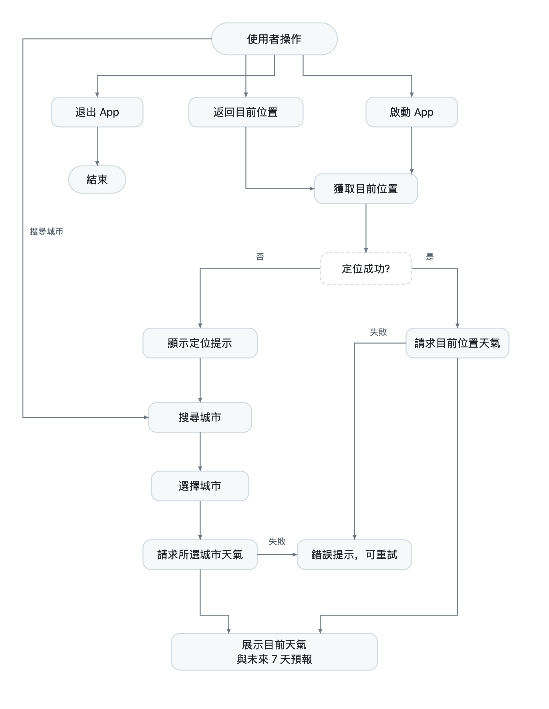

# 設計說明

這份文件說明技術選擇、狀態與錯誤的處理方式，以及每一項取捨背後的代價。  

## 1. 範圍

需求是「搜尋地點、查看目前天氣狀況、查看天氣預報資訊、妥善處理載入中（Loading）及錯誤（Error）狀態」。我把它理解成一個可以從冷啟動走到結束的完整流程，而不是四個獨立畫面：

- 冷啟動先拿目前位置的天氣；拿不到位置時，仍然可以搜尋城市。
- 使用者主動選過城市，頁面回到選擇城市；按下「返回目前位置」會恢復定位天氣。
- 搜尋、載入、成功、失敗、無結果，五種狀態都有對應畫面與出口。

## 2. 取捨

| 項目 | 選擇 | 理由 | 代價 | 何時會改 |
| --- | --- | --- | --- | --- |
| UI | UIKit | 考慮現有技術棧的一致性 | 狀態更新要手寫 `render` | 團隊已全面 SwiftUI |
| 平台 | 原生 Swift，不用 Flutter | 被評的是狀態收斂與取消，這些寫在 `Task` 上比寫在 widget 樹上清楚 | 只覆蓋 iOS | 要同時出 多平台 |
| 架構 | MVVM + Repository | ViewModel 不 import UIKit，狀態可脫離畫面測 | 每次狀態變化多一跳閉包 | 頁面幾乎沒有非同步狀態時 |
| 狀態綁定 | 閉包，不用 Combine | 只有一個訂閱者，`[weak self]` 就寫在 `viewDidLoad`，誰持有誰看得見 | 沒有運算子的組合能力 | 一個狀態要驅動多個畫面 |
| 業務流程 | 不抽 UseCase | 只有一個呼叫方，抽了只得到一行轉發 | ViewModel 同時知道畫面狀態與請求順序 | 出現 Widget／捷徑要複用同一流程 |
| 導航 | `SceneDelegate` 直接串 | 只有兩個畫面，十幾行看得完 | 頁面多了會膨脹 | 有 deep link 或第三條流程 |
| 網路 | `URLSession` + 泛型 `APIClient` | 只有 GET 與 JSON，零第三方依賴 | 無攔截器、重試、日誌 | 出現上傳或 token 刷新 |
| 資料 | DTO → Domain | Open-Meteo 回平行陣列，不能直接餵畫面 | 多一層型別與轉換 | 介面形狀與畫面需求完全一致時 |

 **1.關於API的選擇**  選 Open-Meteo 是因為 Geocoding 和 Forecast 都是公開 GET、不需要 API Key，也不用申請 WeatherKit entitlement，可以直接使用。
 
 **2.為什麼最低支持iOS15**　iOS 15 是系统框架原生支持 async/await 的重要版本节点，兼容需要的API的同時，保留相對廣泛的兼容性。

 **3.不引入 CocoaPods 或其他第三方依赖**　UI，網絡，json，定位這些都可以使用係統框架完成，不需要安裝依賴和升級，克隆後Xcode可以直接打開編譯。後期如果更多的需求出現需要再引入第三方庫。

 **4.為什麼不引 Combine**　只有 ViewController 一個訂閱者。`onStateChange` 寫在 `viewDidLoad`，斷開的地方看得到。當訂閱者變多，同一個狀態驅動多個界面，或者需要防抖。合併意外的響應式組合時，再評估選用combine或者rxswift。

## 3. 狀態設計

每個畫面只有一個狀態來源，用 enum 表達，不用多個 Bool 併存。

`WeatherViewState`：

| 狀態                                     | 畫面   | 出口           |
| -------------------------------------- | ---- | ------------ |
| `idle`                                 | 空白   | 等待首次載入       |
| `loading`                              | 指示器  | —            |
| `loaded(WeatherResult)`                | 內容   | 切換城市         |
| `error(String)`                        | 錯誤文案 | 重試、搜尋城市      |
| `locationUnavailable(LocationProblem)` | 定位說明 | 重試、前往設定、搜尋城市 |

`CitySearchViewState`：`idle`、`loading`、`results([Location])`、`empty`、`error(String)`。

關鍵是 `empty` 與 `error` 分開：搜尋「zzzzz」沒有結果，不是請求失敗，畫面不該出現重試按鈕。同理 `locationUnavailable` 不與天氣 `error` 合併——定位被拒絕時重試沒有意義，該給的是「前往設定」。

## 4. 競態與取消

| 情境           | 機制                                     | 結果                   |
| ------------ | -------------------------------------- | -------------------- |
| 快速切換深圳→上海→東京 | 新請求 `cancel()` 舊 `Task`，`requestID` 遞增 | 只有東京寫入畫面             |
| 上海的舊回應比東京晚到  | 回應後比對 `requestID`                      | 舊請求被丟棄               |
| 舊請求以網路錯誤結束   | 同一個 `requestID` 檢查                     | 不會把已成功的新狀態改成 `error` |
| 使用者取消（離開搜尋頁） | `cancel()` + `Task.isCancelled`        | 不顯示錯誤                |
| 定位晚於城市選擇返回   | 定位與反查後各檢查一次 `requestID`                | 不會覆蓋已選城市，也不會多發一次天氣請求 |
| 搜尋每輸入一個字     | 300ms 防抖                               | 只送出最後一個關鍵字           |

取消之所以不能被當成錯誤，是因為 `URLSession` 會把 `CancellationError` 橋接成 `NSError`，Swift 端 `as? CancellationError` 會失手。`APIClient` 因此同時比對 cancellation domain 與 `NSURLErrorCancelled`，把取消語意還原後再往上拋。

## 5. 錯誤處理

錯誤在網路層分類，在 ViewModel 翻譯成畫面語言，兩層職責不混。

| 來源         | 判斷                                        | 使用者看到            |
| ---------- | ----------------------------------------- | ---------------- |
| HTTP 非 2xx | `APIError.httpError`                      | 伺服器暫時無法使用        |
| 逾時         | `URLError.timedOut` → `APIError.timeout`  | 連線逾時             |
| 連線失敗       | 其他 `URLError` → `APIError.transportError` | 網路連線失敗           |
| 解碼失敗       | `APIError.decodingError`                  | 資料格式有誤           |
| 定位被拒絕      | `LocationAccessError.denied`              | 說明 + 前往設定 + 搜尋城市 |
| 定位服務關閉     | `.servicesDisabled`                       | 說明 + 前往設定 + 搜尋城市 |
| 單次定位失敗     | `.failed`                                 | 說明 + 重試 + 搜尋城市   |
| 反查地名失敗     | 不視為錯誤                                     | 用「目前位置」繼續查天氣     |

