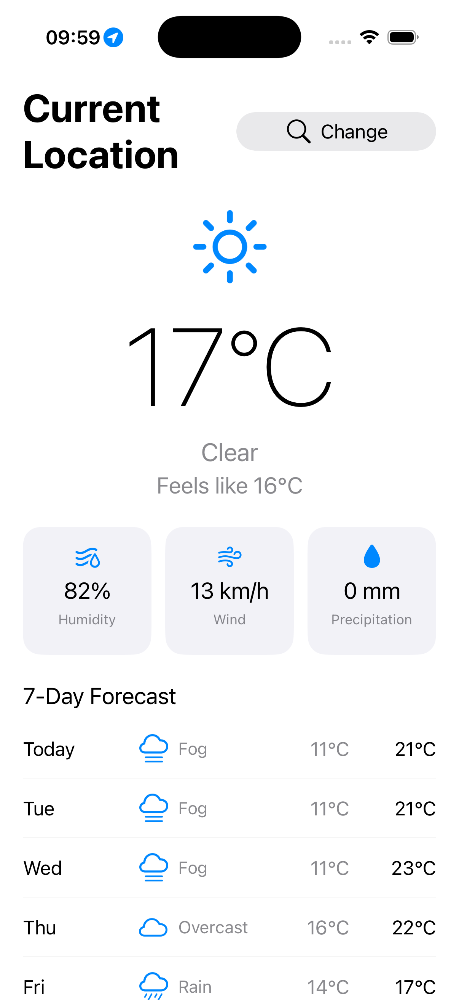
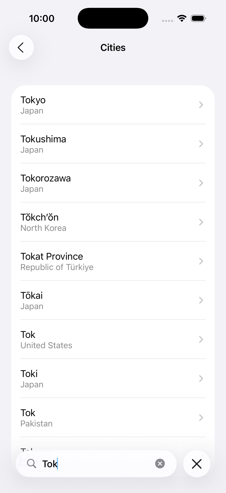
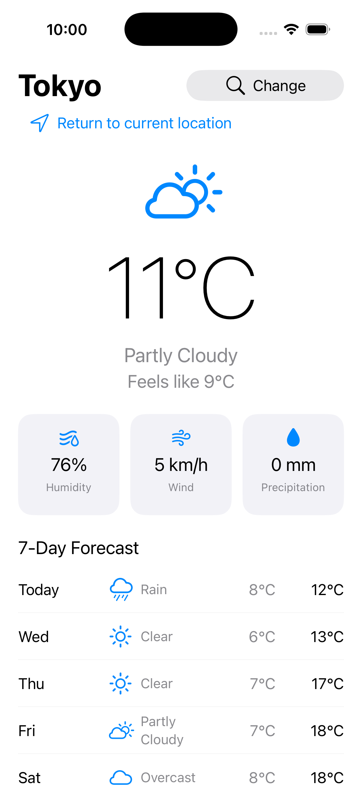
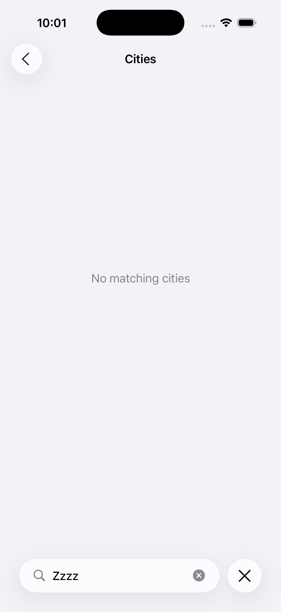

# WeatherApp

iOS 天氣應用，使用 UIKit 建構。使用者可以搜尋城市查看目前天氣與七日預報；啟動時會取得目前位置的天氣。天氣資料來自 [Open-Meteo](https://open-meteo.com/)（Geocoding + Forecast），不需要 API Key。

| 目前位置天氣 | 城市搜尋 | 切換城市 | 搜尋無結果 |
| --- | --- | --- | --- |
|  |  |  |  |

設計與取捨見 [DESIGN.md](DESIGN.md)。

## 功能

- 啟動時取得目前位置天氣
- 搜尋城市並切換天氣，300ms 防抖，離開頁面自動取消進行中的搜尋
- 可隨時從搜尋城市返回目前位置
- 顯示目前溫度、體感溫度、濕度、風速、降水量與天氣狀況，以及未來 7 天預報
- 載入中、錯誤重試、搜尋無結果、定位被拒絕，各自有獨立狀態與出口
- 定位失敗不影響搜尋；反查地名失敗不影響查天氣
- 介面語言跟隨系統：英文、簡體中文、繁體中文
- VoiceOver：指標卡片與預報行各自是一個完整的朗讀單位

## 技術棧

- Swift 5 / UIKit / Auto Layout / MVVM
- URLSession + async/await、`Task` 取消、`@MainActor`
- Codable（DTO → Domain Model 轉換）
- CoreLocation（單次定位 + CLGeocoder 反查）
- XCTest 

未引入第三方依賴，克隆後用 Xcode 開啟即可編譯。

## 專案結構

```text
WeatherApp/
  AppEnvironment.swift                   依賴組裝唯一入口（正式 / UI 測試兩套）
  AppDelegate.swift                      App 生命週期
  SceneDelegate.swift                    Window 建立、頁面跳轉
  Core/
    Networking/                          APIClient、Endpoint、APIError
    Location/                            單次定位、反查地名、可取消的等待
    Testing/                             UI 測試替身（#if DEBUG）
  Features/Weather/
    Domain/                              領域模型與 Repository 協議
    Data/                                DTO、Open-Meteo 實作
    Presentation/                        ViewController、ViewModel、可複用 View、L10n
WeatherAppTests/                         單元測試，不存取真實 GPS 與外網
WeatherAppUITests/                       端到端流程測試，以 -UITestMode 隔離外部依賴
docs/                                    架構說明與截圖
```

## 執行和測試

1. 使用 Xcode 26 開啟 `WeatherApp.xcodeproj`
2. 選擇 `WeatherApp` Scheme，`Cmd+R` 執行
3. 測試：Cmd+U 執行全部測試。單元測試不存取真實 GPS 與外網；UI 測試以啟動參數 -UITestMode 把定位與網路換成固定結果，結果可重現。唯一例外是 ScreenshotTests：它用 -PreviewCoordinates 固定座標但走真實 API，用來產生 README 的截圖，需要網路。 

- 最低支援系統：iOS 15
- 裝置：iPhone，直向
- README 截圖由 模擬器測試 截圖

## 目前限制

- 不提供小時預報、天氣預警和空氣品質資訊，不做離線快取
- 溫度單位為攝氏度，風速單位為 km/h，不提供單位切換
- 每次啟動重新定位，不儲存歷史搜尋記錄
- 系統語言為英文、簡體中文或繁體中文以外的語言時，介面預設使用英文
